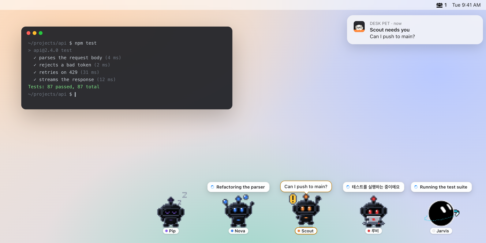
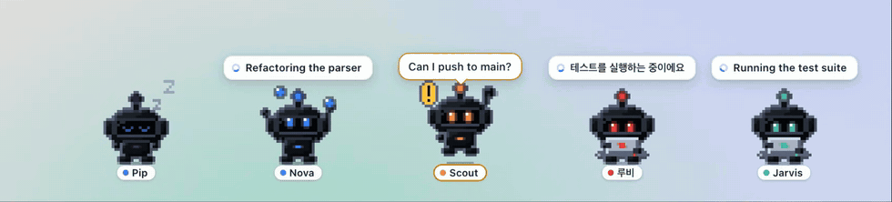
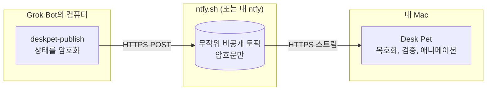

<p align="center">
  
  <br />
  <sub>펫들은 Grok Bot 아바타 모습이에요(Jarvis는 기본 아바타). 이 그림은 Grok Bot의 것이라 Desk Pet에는 들어 있지 않고, 내 Grok Bot에서 복사해 와요. Grok Bot이 없으면 Desk Pet의 픽셀 로봇이 나와요.</sub>
</p>

<h1 align="center">Desk Pet</h1>

<p align="center">
  <strong>내 Grok Bot마다 데스크톱에 픽셀 아트 펫이 하나씩.</strong><br />
  어떤 봇이 생각 중인지, 일하는 중인지, 끝났는지, 나를 기다리는지 한눈에 보여요.
</p>

<p align="center">
  <a href="https://github.com/junlee30/grokbot-deskpet/releases/latest"></a>
  <a href="https://www.npmjs.com/package/deskpet-publish"></a>
  <a href="https://github.com/junlee30/grokbot-deskpet/actions/workflows/ci.yml"></a>
  
  <a href="LICENSE"></a>
</p>

<p align="center">
  <a href="README.md">English</a> · <a href="README.ko.md">한국어</a>
</p>

<p align="center"><sub>xAI와 관련이 없는 비공식 개인 프로젝트예요.</sub></p>

---

## 설치

Desk Pet은 macOS(Apple 실리콘, Intel)에서 돌아가요. 편한 방법을 골라 주세요:

**Grok Bot에게 맡기기.** 이 줄을 붙여 넣으세요:

```text
https://raw.githubusercontent.com/junlee30/grokbot-deskpet/main/docs/BOT-INSTALL.md 을 따라서 내 Mac에 Desk Pet을 설치해 줘
```

봇이 Desk Pet을 설치하고 열어 줘요(Homebrew가 있으면 Homebrew로, 없으면 SHA-256으로 확인한 릴리스로). 그다음 **Grok Bot 연결하기**에서 복사한 줄을 달라고 해요. 봇이 내 Mac에서 명령을 실행할 수 없으면 아래 방법 중 무엇을 쓰면 되는지 알려 줘요.

**Homebrew** ([brew.sh](https://brew.sh)). `brew upgrade --cask desk-pet`으로 업데이트하기 가장 쉬워요:

```bash
brew install --cask junlee30/tap/desk-pet
```

**다운로드:** **[최신 릴리스](https://github.com/junlee30/grokbot-deskpet/releases/latest)**에서 `.dmg`를 받아 열고, **Desk Pet**을 응용 프로그램 폴더로 끌어다 놓으세요.

**소스에서:** [직접 빌드하기](#직접-빌드하기)를 봐 주세요.

> [!NOTE]
> 아직 Apple 개발자 ID로 서명하지 않은 앱이에요. 처음 열 때는 **Desk Pet.app을 오른쪽 클릭 → 열기**를 누르거나, 시스템 설정 → 개인정보 보호 및 보안에서 허용해 주세요. 그래도 열리지 않으면 다운로드 표시를 지우세요:
> ```bash
> xattr -dr com.apple.quarantine "/Applications/Desk Pet.app"
> ```

## 붙여 넣기 한 번으로 봇 연결

1. Desk Pet을 열고 **Grok Bot 연결하기** → **복사**를 누르세요.
2. 복사한 한 줄을 Grok Bot에게 붙여 넣으세요. 봇이 링크에서 스킬을 읽고, 작은 퍼블리셔 스크립트를 설치하고(고정된 SHA-256으로 검증), 페어링한 뒤 인사를 보내요.
3. 1초쯤 뒤 데스크톱에 그 봇의 펫이 나타나요.

봇이 몇 개든 같은 한 줄을 쓰면 돼요. 이 줄에는 펫의 열쇠가 들어 있으니 내 봇에게만 알려 주세요.

### 다른 에이전트와 스크립트

봇 쪽은 `deskpet-publish`라는 작은 스크립트 하나예요. Grok Bot은 붙여 넣은 줄을 보고 알아서 설치하고, 명령을 실행할 수 있는 다른 것들은 npm에서 받아 펫을 움직일 수 있어요:

| | |
| --- | --- |
| **설치 없이 실행** | `npx -y deskpet-publish@2.2.0 --help` |
| **명령어로 설치** | `npm install -g deskpet-publish` |
| **한 번 페어링하고 보내기** | `pbpaste \| deskpet-publish pair` → `deskpet-publish init my-bot "My Bot"` → `deskpet-publish --bot my-bot working tool_start "Running tests"` |

스킬이 SHA-256으로 고정해 둔 것과 같은 파일이고, 이 저장소에서 [npm provenance](https://docs.npmjs.com/generating-provenance-statements)와 함께 게시돼요. 자세한 내용: [skill/README.md](skill/README.md)(영어).

<p align="center">
  
</p>

## 이런 걸 할 수 있어요

- **봇마다 펫 하나.** 펫은 각자 작은 창에 있어서 어느 모니터든 원하는 곳으로 끌어다 놓을 수 있고, 위치는 기억돼요.
- **한눈에 읽히는 상태:** 생각할 땐 생각 구름, 일할 땐 깡충 뛰며 도는 고리, 여러 일을 동시에 할 땐 저글링, 나를 기다릴 땐 깜빡이는 `!`, 오류엔 빨간 `×`, 끝나면 축하 꽃가루, 쉴 땐 z.
- **짧은 상태 말풍선:** "테스트 실행 중", "main에 푸시해도 될까요?" 같은 것들이요. 내 질문, 봇의 답변, 도구 인자, 파일 내용은 절대 보내지 않아요.
- **"기다리는 중" 알림:** 봇이 나를 기다리기 시작하면 macOS 알림이 오고, 메뉴 막대 아이콘에 기다리는 봇 수가 표시돼요.
- **펫을 클릭**하면 Grok Bot에서 그 봇과의 채팅이 열려요. **오른쪽 클릭**하면 봇이 새 일을 시작할 때까지 그 펫만 숨길 수 있어요.
- **내 언어로 말해요.** 봇은 나와 대화하는 언어로 상태를 쓰고, 펫이 보여 주는 문구도 그 봇의 언어를 따라가요. 앱 창과 메뉴는 Grok Bot처럼 Mac의 언어 설정을 따라요. 지금은 영어와 한국어를 지원해요.
- **내 봇처럼 생겼어요.** 같은 Mac에 Grok Bot이 있으면 위의 펫들처럼 각 펫이 그 봇의 프로필 사진 모양으로 그려져요. 그림은 Desk Pet이 시작할 때 내 Grok Bot에서 복사해 오고, Desk Pet 자체에는 들어 있지 않아요. Grok Bot이 없으면 봇 색깔의 오리지널 픽셀 로봇이 나와요.
- **라이트·다크 모드, 동작 줄이기, 대비 증가**를 지원해요. Dock 대신 메뉴 막대에 살아요.

## 작동 방식

Desk Pet 서버는 없어요. 봇과 내 Mac은 서로 직접 연결할 수 없어서, 둘 다 닿을 수 있는 메일박스에서 만나요. 그 메일박스는 암호문만 볼 수 있어요.



- 페어링 코드에는 무작위 토픽 이름과 256비트 키가 들어 있어요. 모든 상태는 봇의 컴퓨터를 떠나기 전에 **XChaCha20-Poly1305**로 암호화돼요.
- 메일박스가 보는 건 토픽 이름, 암호화된 메시지와 그 크기·시각, IP 주소뿐이에요. 상태를 읽거나 위조할 수 없고, ntfy.sh는 메시지를 최대 12시간만 보관해요.
- Desk Pet은 코드를 macOS 키체인에 보관하고, 복호화에 실패하거나 재전송됐거나 10분 넘게 지난 메시지는 버려요.

자세한 내용: [docs/PROTOCOL.md](docs/PROTOCOL.md) (영어). 보안 문제를 발견했다면 [SECURITY.md](SECURITY.md)를 봐 주세요.

## 설정

메뉴 막대 아이콘 → **설정…** (또는 펫을 오른쪽 클릭):

- **페어링:** **코드 보기**(다른 봇 컴퓨터용), **새 코드**(기존 봇은 더 이상 들리지 않아요), **페어링 해제**.
- **스킬:** **스킬 링크 복사**. Grok Bot 스킬 라이브러리에 직접 추가할 때 써요.
- **메일박스:** `https://ntfy.sh` 또는 내 ntfy 서버. 다음에 만드는 새 코드부터 적용돼요.
- **펫 크기**, **알림**("봇이 나를 기다리면 알려 주기"), **펫 위치 초기화**.

## 문제 해결

- **"업데이트 N개를 놓쳤어요":** 무료 ntfy.sh 메일박스는 IP 주소 하나당 하루 약 250개 메시지까지 받아요. 같은 컴퓨터의 봇들이 이 한도를 나눠 써요. 봇에게 ntfy 액세스 토큰을 주거나(`deskpet-publish token`), 직접 ntfy를 운영하고 **메일박스**를 바꾸세요.
- **펫이 스킬이 오래됐다고 해요:** ⚙ → **스킬 링크 복사** 후 그 봇에게 링크를 보내 Desk Pet 스킬을 업데이트해 달라고 하세요.
- **펫이 계속 "작업 중"이에요:** 상태는 봇이 직접 보내요. 봇이 `done`을 깜빡하면 펫이 바쁜 채로 남지만, 10분 동안 소식이 없으면 쉬는 상태로 돌아가요.
- **펫이 흐려졌어요:** 메일박스에 연결할 수 없는 상태예요. 잠자기에서 깨어난 뒤에도 Desk Pet이 알아서 다시 연결해요.
- **로그:** `~/Library/Logs/dev.deskpet.grokbot/deskpet.log` (비밀 정보는 기록하지 않아요). [버그 제보](https://github.com/junlee30/grokbot-deskpet/issues/new/choose)할 때 함께 첨부해 주세요.

## 직접 빌드하기

Node 22 이상, Rust, `cargo install tauri-cli --version ^2`가 필요해요:

```bash
cd desktop && npm install && cargo tauri build
open "src-tauri/target/release/bundle/macos/Desk Pet.app"
```

## 문서 (영어)

- [docs/PROTOCOL.md](docs/PROTOCOL.md): 페어링, 암호화, 이벤트 형식, 펫이 확인하는 것들.
- [docs/DESIGN.md](docs/DESIGN.md): 디자인, 데스크톱 동작, 언어, Grok Bot 아바타 그림.
- [docs/DEVELOPMENT.md](docs/DEVELOPMENT.md): 구조, 테스트, 릴리스.
- [skill/SKILL.md](skill/SKILL.md): Grok Bot이 따르는 지침.
- [CHANGELOG.md](CHANGELOG.md): 릴리스별 변경 사항.

## 라이선스

Apache-2.0. [LICENSE](LICENSE)를 보세요. Desk Pet은 독립 프로젝트이며, Grok Bot과 그 그림은 각 소유자의 것이에요.
