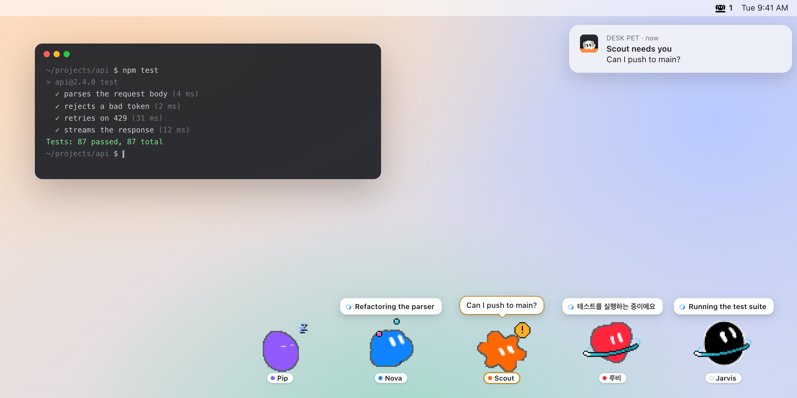
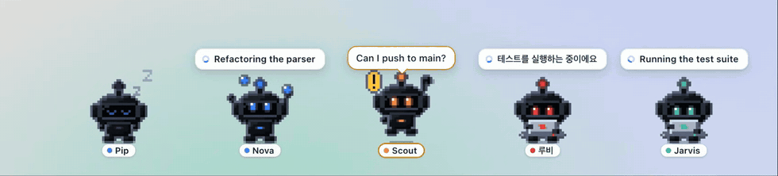
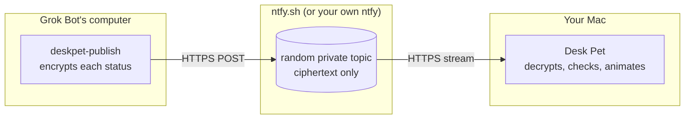

<p align="center">
  
  <br />
  <sub>The pets wear Grok Bot avatars (Jarvis has the default one). That's Grok Bot's art: Desk Pet doesn't include it, it copies it from your own Grok Bot. Without Grok Bot, pets are Desk Pet's own pixel-art robot.</sub>
</p>

<h1 align="center">Desk Pet</h1>

<p align="center">
  <strong>A pixel-art pet on your desktop for each of your Grok Bots.</strong><br />
  See at a glance which bot is thinking, working, done, or waiting for you.
</p>

<p align="center">
  <a href="https://github.com/junlee30/grokbot-deskpet/releases/latest"></a>
  <a href="https://github.com/junlee30/grokbot-deskpet/actions/workflows/ci.yml"></a>
  
  <a href="LICENSE"></a>
</p>

<p align="center">
  <a href="README.md">English</a> · <a href="README.ko.md">한국어</a>
</p>

<p align="center"><sub>Unofficial side project, not affiliated with or endorsed by xAI.</sub></p>

---

## Download

**[Download Desk Pet for macOS](https://github.com/junlee30/grokbot-deskpet/releases/latest)** (Apple silicon and Intel), open the `.dmg` and drag **Desk Pet** to Applications.

> [!NOTE]
> Desk Pet isn't signed with an Apple Developer ID yet. The first time, **right-click Desk Pet.app → Open**, or allow it in System Settings → Privacy & Security. If macOS still refuses, clear the download flag:
> ```bash
> xattr -dr com.apple.quarantine "/Applications/Desk Pet.app"
> ```

## Connect a bot in one paste

1. Open Desk Pet and click **Connect your Grok Bot**, then **Copy**.
2. Paste the line to your Grok Bot. It reads the skill from the link, installs a small publisher script (checked against a pinned SHA-256), pairs, and says hello.
3. Its pet pops up on your desk within about a second.

The same line works for every bot you have. It contains the key to your pets, so only share it with your own bots.

<p align="center">
  
</p>

## What you get

- **One pet per bot**, each in its own small window you can drag anywhere, on any monitor. Positions are remembered.
- **States you can read at a glance:** a thought cloud while thinking, a hop and spinning ring while working, juggling balls when helpers run in parallel, a pulsing `!` when the bot needs you, a red `×` on errors, confetti when done, z's when asleep.
- **Short status bubbles** like "Running tests" or "Can I push to main?". Bots never send your prompts, their replies, tool arguments or file contents.
- **"Needs you" notifications**, and the menu bar icon shows how many bots are waiting.
- **Click a pet** to open that bot's chat in Grok Bot. **Right-click** to hide it until its bot does something new.
- **Speaks your language.** Bots write their status in the language you talk to them in, and each pet's own text follows its bot. The app's windows and menus follow your Mac's language, like Grok Bot. English and Korean so far.
- **Looks like your bots.** With Grok Bot on the same Mac, each pet is drawn as its bot's own profile picture, like the pets above, copied from your Grok Bot when Desk Pet starts (Desk Pet never ships that art). Without Grok Bot, pets are Desk Pet's original pixel-art robot in each bot's colour.
- **Light and dark mode, Reduced Motion, Increase Contrast.** It lives in the menu bar, not the Dock.

## How it works

There is no Desk Pet server. Your bots and your Mac can't reach each other directly, so they meet at a mailbox both can reach, and that mailbox only ever sees ciphertext.



- The pairing code holds a random topic name and a 256-bit key. Each status is encrypted with **XChaCha20-Poly1305** before it leaves the bot's computer.
- The mailbox sees the topic name, encrypted messages, their size and timing, and IP addresses. It can't read or forge a status, and ntfy.sh keeps messages for at most 12 hours.
- Desk Pet keeps the code in your macOS Keychain and drops anything that fails to decrypt, is a replay, or is more than 10 minutes old.

Details: [docs/PROTOCOL.md](docs/PROTOCOL.md). Found a security problem? See [SECURITY.md](SECURITY.md).

## Settings

Menu bar icon → **Settings…** (or right-click a pet):

- **Pairing:** **Show code** (for another bot computer), **New code** (old bots go unheard), **Unpair**.
- **Skill:** **Copy Skill Link**, to add Desk Pet to your Grok Bot skill library by hand.
- **Mailbox:** `https://ntfy.sh` or your own ntfy server, used for the next new code.
- **Pet size**, **Alerts** ("Notify me when a bot needs me") and **Reset Pet Positions**.

## Troubleshooting

- **"Missed N updates":** the free ntfy.sh mailbox allows about 250 messages a day per IP address, shared by every bot on that computer. Give your bots an ntfy access token (`deskpet-publish token`) or run your own ntfy and set **Mailbox**.
- **A pet says its skill is out of date:** ⚙ → **Copy Skill Link** and send the link to that bot, asking it to update its Desk Pet skill.
- **A pet stays "working":** bots post their own status, so a bot that forgets to post `done` leaves its pet busy. Busy states fade to idle after 10 minutes without an update.
- **Pets are dimmed:** the mailbox can't be reached. Desk Pet reconnects by itself, including after sleep.
- **Logs:** `~/Library/Logs/dev.deskpet.grokbot/deskpet.log` (never contains secrets). Please include it in [bug reports](https://github.com/junlee30/grokbot-deskpet/issues/new/choose).

## Build it yourself

Node 22+, Rust and `cargo install tauri-cli --version ^2`:

```bash
cd desktop && npm install && cargo tauri build
open "src-tauri/target/release/bundle/macos/Desk Pet.app"
```

## Documentation

- [docs/PROTOCOL.md](docs/PROTOCOL.md): pairing, encryption, the event format, what the pet checks.
- [docs/DESIGN.md](docs/DESIGN.md): look and feel, desktop behaviour, languages, Grok Bot avatar art.
- [docs/DEVELOPMENT.md](docs/DEVELOPMENT.md): architecture, tests, releasing.
- [skill/SKILL.md](skill/SKILL.md): what your Grok Bot is told to do.
- [CHANGELOG.md](CHANGELOG.md): what changed in each release.

## License

Apache-2.0. See [LICENSE](LICENSE). Desk Pet is an independent project; Grok Bot and its art belong to their owners.
